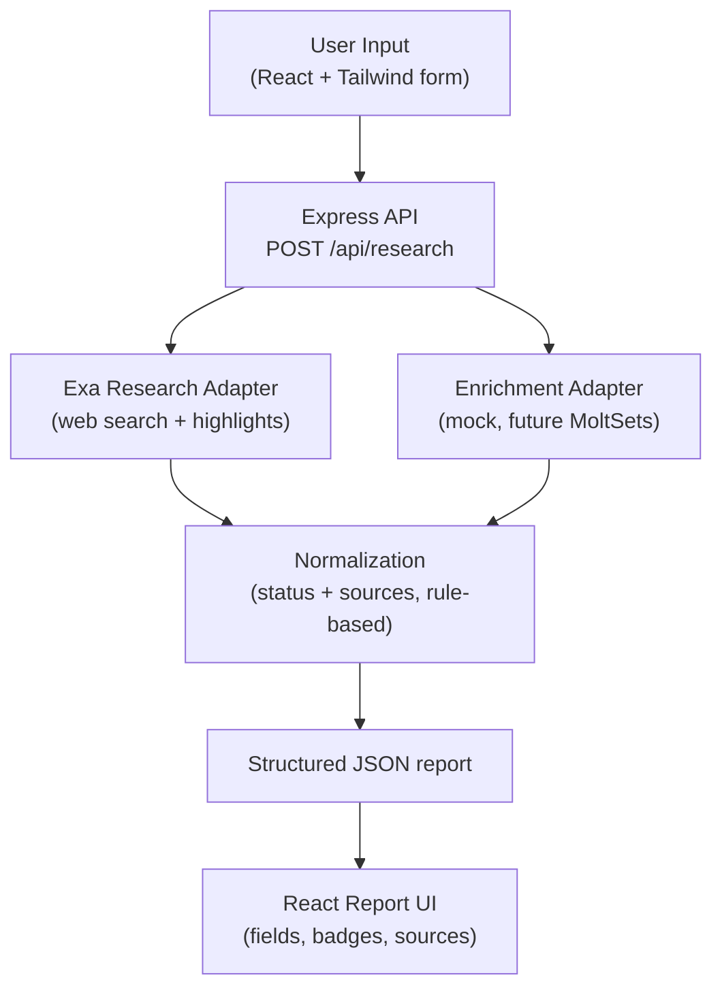

# Outmate GTM Research & Enrichment Prototype

## Overview

An AI-powered GTM research prototype: give it a company name and/or website plus
an optional objective, and it researches the company with Exa, enriches it via a
swappable provider (mock today), and returns a structured report where **every
field is source-tagged** — nothing is fabricated.

## Features

- **Company research via Exa** — focused queries (overview, funding, hiring, product, leadership).
- **Structured GTM report** — fixed JSON schema from raw research + enrichment.
- **Per-field status and sources** — `verified` / `provider-reported` / `inferred` / `unavailable`, with source links.
- **Missing-data and warnings panel** — surfaces `missingFields` and warnings, plus a mock-data banner.
- **JSON export** — Download JSON and Copy JSON from the report UI.

## Tech stack

- **Client:** React + Vite + Tailwind CSS
- **Server:** Node.js + Express (ES modules)
- **Language:** plain JavaScript (no TypeScript)
- **Tests:** Vitest (+ supertest) in `/server`

**Trade-offs:** JavaScript over TypeScript for speed in a 1–3 day prototype; no
database — only a short-lived **in-memory cache** so no sensitive data is stored.

## Architecture

See [`docs/architecture.md`](docs/architecture.md) for the full write-up and the
field status model.



## Folder structure

```
outmate-gtm-prototype/
├── client/                      # React + Vite + Tailwind
│   ├── index.html
│   ├── vite.config.js           # dev proxy: /api -> http://localhost:4000
│   └── src/
│       ├── api/research.js      # POST /api/research wrapper
│       ├── components/
│       │   ├── ResearchForm.jsx
│       │   └── ReportView.jsx
│       ├── App.jsx
│       ├── index.css
│       └── main.jsx
├── server/                      # Node.js + Express (ES modules)
│   ├── .env.example
│   ├── scripts/try-exa.js       # quick Exa smoke test
│   ├── vitest.config.js
│   ├── src/
│   │   ├── app.js               # Express app (testable, no listen)
│   │   ├── index.js             # server bootstrap
│   │   ├── config.js            # env loading + warnings
│   │   ├── middleware/errorHandler.js
│   │   ├── providers/
│   │   │   ├── exa/exaAdapter.js
│   │   │   └── enrichment/
│   │   │       ├── index.js
│   │   │       ├── mockAdapter.js
│   │   │       └── moltsetsAdapter.js   # documented stub
│   │   ├── routes/research.js
│   │   ├── services/
│   │   │   ├── researchService.js        # orchestration + cache
│   │   │   └── normalize.js              # rule-based normalization
│   │   └── utils/{errors.js, http.js}
│   └── tests/
├── docs/
│   ├── architecture.md
│   ├── enrichment-provider-notes.md
│   └── product-research.md
└── examples/
    ├── input.json
    └── stripe-output.json
```

## Setup

Prerequisites: **Node 18+**.

```bash
# 1) Server
cd server
npm install
cp .env.example .env        # then add your EXA_API_KEY
npm run dev                 # http://localhost:4000

# 2) Client (new terminal)
cd client
npm install
npm run dev                 # http://localhost:5173
```

Get an Exa key at https://dashboard.exa.ai/api-keys (free credits on new
accounts). The client talks to the server through the **Vite dev proxy**
(`/api` → `http://localhost:4000`), so no CORS setup is needed in dev.

## Environment variables

| Variable | Required | Default | Description |
| --- | --- | --- | --- |
| `EXA_API_KEY` | Yes | — | Exa API key. Server-side only; a warning is logged if missing. |
| `PORT` | No | `4000` | Express server port. |
| `ENRICHMENT_MODE` | No | `mock` | Enrichment provider. Only `mock` is supported; any other value warns and falls back to mock. |

## API reference

### `POST /api/research`

Request body:

```json
{
  "name": "Stripe",
  "domain": "https://www.stripe.com",
  "objective": "assess fit for an AI-powered GTM research and enrichment tool"
}
```

- At least one of `name` or `domain` is required.
- `objective` is optional, max 500 characters.
- The domain is normalized (protocol, `www.`, paths, query strings, trailing
  slashes stripped; lowercased).

Example response (shortened — full sample in
[`examples/stripe-output.json`](examples/stripe-output.json)):

```json
{
  "companyName": {
    "value": "Stripe",
    "status": "verified",
    "sources": ["https://stripe.com/about"]
  },
  "description": {
    "value": "Stripe is a technology company focused on…",
    "status": "verified",
    "sources": ["https://stripe.com/about"]
  },
  "industry": { "value": null, "status": "unavailable", "sources": [], "note": "mock data" },
  "gtmOpportunity": {
    "value": "Recent funding signals suggest budget for new tooling…",
    "status": "inferred",
    "sources": ["https://techcrunch.com/…"]
  },
  "growthSignals": [
    {
      "type": "funding",
      "summary": "Stripe raised…",
      "date": "2026-02-24T00:00:00.000Z",
      "sourceUrl": "https://techcrunch.com/…"
    }
  ],
  "decisionMakers": [],
  "contactInfo": { "value": null, "status": "unavailable", "sources": [], "note": "mock data" },
  "sources": [
    { "title": "About Us | Stripe", "url": "https://stripe.com/about", "publishedDate": null }
  ],
  "missingFields": ["industry", "employeeSize", "decisionMakers", "contactInfo"],
  "warnings": ["Enrichment data is mock; not treated as provider-reported."],
  "generatedAt": "2026-10-17T17:13:37.749Z"
}
```

Error format:

```json
{ "error": { "code": "VALIDATION_ERROR", "message": "At least one of 'name' or 'domain' is required" } }
```

Error codes: `VALIDATION_ERROR` (400), `PROVIDER_AUTH` (502),
`PROVIDER_TIMEOUT` (504), `PROVIDER_RATE_LIMIT` (429), `PROVIDER_ERROR` (502),
`NOT_FOUND` (404).

## Error handling notes

- **Timeouts:** outbound calls use `AbortController` with a timeout.
- **Retries:** 429/5xx are retried up to 2 times with exponential backoff,
  honoring `Retry-After`.
- **Partial Exa failures:** if some queries fail, the others' results still
  return and each failure is recorded in `warnings`.
- **Enrichment failure:** never fails the request — it continues with `null`
  enrichment and adds a warning.
- **No data:** zero results (and even a failed enrichment) still return **200**
  with all fields `unavailable` and clear warnings — never a 500.
- **Validation:** bad input returns **400** `VALIDATION_ERROR`.

## Enrichment

**Enrichment is mocked; real MoltSets integration is not implemented. Mock data
is never shown as `provider-reported`, and contacts are never generated.**

**Why mock:** MoltSets/Moldset API access and credentials were not available for
this prototype (a hard blocker — no paid calls and no keys to integrate
against), so the provider sits behind a documented stub and the mock keeps the
full pipeline runnable and testable without fabricating company facts or
contacts.

See [`docs/enrichment-provider-notes.md`](docs/enrichment-provider-notes.md).
Plugging in a real provider means implementing `enrichCompany`, registering it
in `providers/enrichment/index.js`, and setting `ENRICHMENT_MODE`.

## Testing

```bash
cd server
npm test
```

Covers: field status rules and mock handling (`normalize.test.js`), Exa error
mapping and retry/timeout behavior with a mocked `fetch` (`exaAdapter.test.js`),
service-level fallback and all-empty reports (`researchService.test.js`), and
route validation with supertest (`research.route.test.js`). Tests make **no real
network calls**.

## Known limitations

- Enrichment is mocked; no real provider integrated.
- Growth-signal detection is rule-based (keywords) and can miss or misclassify.
- `gtmOpportunity` is a rule-based hypothesis, not analyst judgment.
- Exa free-tier credit limits cap how many queries can be run.
- The in-memory cache resets on restart and is not shared across instances.
- One company per request (no batch mode).

## Next steps

- Integrate **MoltSets** with Outmate-provided credentials.
- Optional alternative providers behind the same adapter:
  **People Data Labs** (company enrichment), **Hunter.io** (domain-based contacts).
- LLM-based summarization **with citations**.
- Persistent storage of reports with timestamps.
- Batch / spreadsheet-style research mode.
- Contact discovery with verification metadata.

## Links

- Product research: [`docs/product-research.md`](docs/product-research.md)
- Enrichment notes: [`docs/enrichment-provider-notes.md`](docs/enrichment-provider-notes.md)
- Demo video: `DEMO_VIDEO_LINK`
