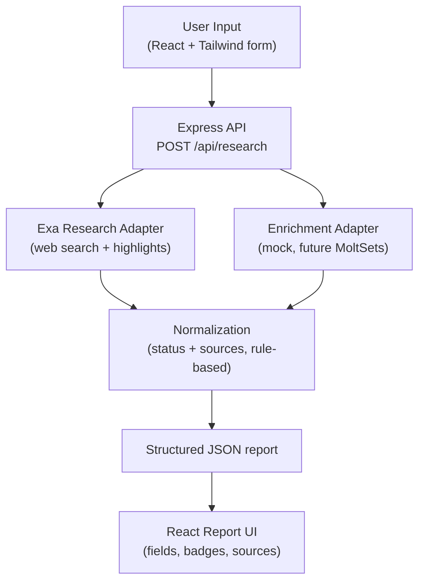

# Architecture

## High-level flow

The request is validated and the domain normalized in the route, then
`researchService.runResearch` orchestrates Exa research and enrichment in
parallel conceptually (enrichment is fail-soft), and `normalize` turns both raw
outputs into the fixed report schema. The client renders that schema.

## Adapter pattern

Every external provider lives in its own file and exposes the same function
contract:

- Exa: `server/src/providers/exa/exaAdapter.js` → `researchCompany({ name, domain, objective })`
- Enrichment: `server/src/providers/enrichment/*` → `enrichCompany({ name, domain })`

The active enrichment provider is chosen by `getEnrichmentProvider()` in
`server/src/providers/enrichment/index.js` based on the `ENRICHMENT_MODE` env
variable. Because the core (`researchService`, `normalize`, routes, UI) depends
only on the contract — not on a specific vendor — a provider can be added or
replaced without touching the core. A new provider is one new file plus a
registration in the index. See `docs/enrichment-provider-notes.md`.

MoltSets is stubbed (`moltsetsAdapter.js`): it documents the expected shape and
throws `PROVIDER_ERROR` if called. Only `mock` is currently supported.

## Field status model

Every scalar field in the report is `{ value, status, sources: [url], note? }`
with one of four statuses:

| Status | Meaning |
| --- | --- |
| `verified` | Backed by an Exa result URL (a real source link). |
| `provider-reported` | Taken from a **real** enrichment provider value. |
| `inferred` | A reasoned hypothesis. `gtmOpportunity` is always inferred and lists the signals/sources it used. |
| `unavailable` | No supported data. Also used for **mock** data — mock values are never presented as `provider-reported`. |

Rules enforced in `normalize.js`:

- `employeeSize` and funding are never inferred from vague text — only an
  explicit highlight or a real provider value.
- Contacts are never generated. `decisionMakers` comes only from provider
  contacts; otherwise it is empty.
- Mock enrichment fields become `unavailable` with note `"mock data"`.
- `missingFields` lists every field left `unavailable`, plus empty arrays
  (`growthSignals`, `decisionMakers`, `contactInfo`).
